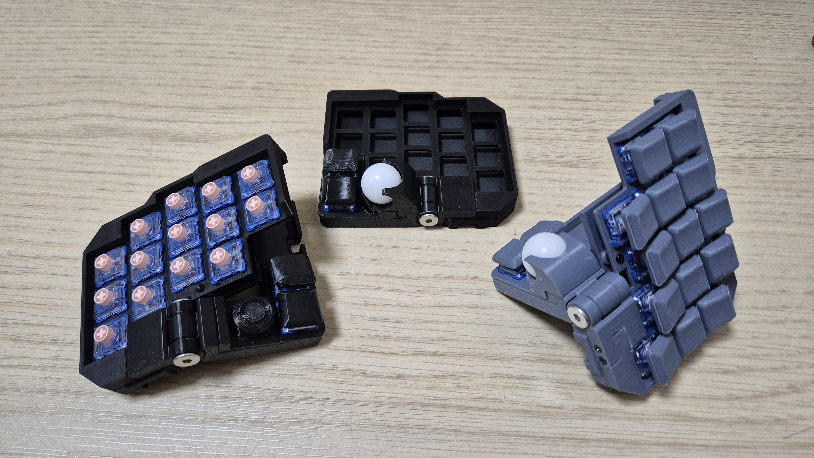
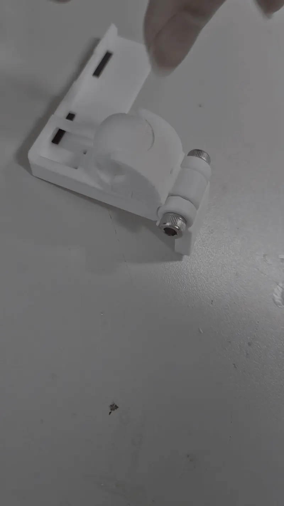
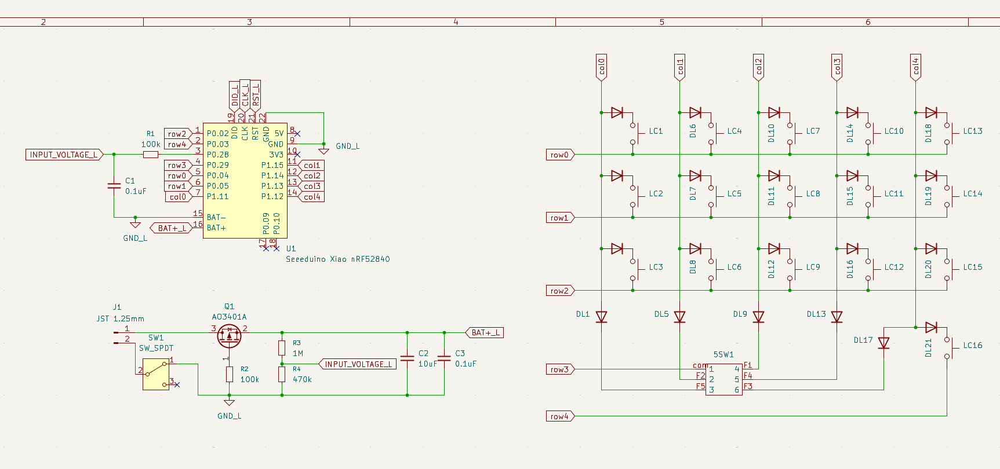
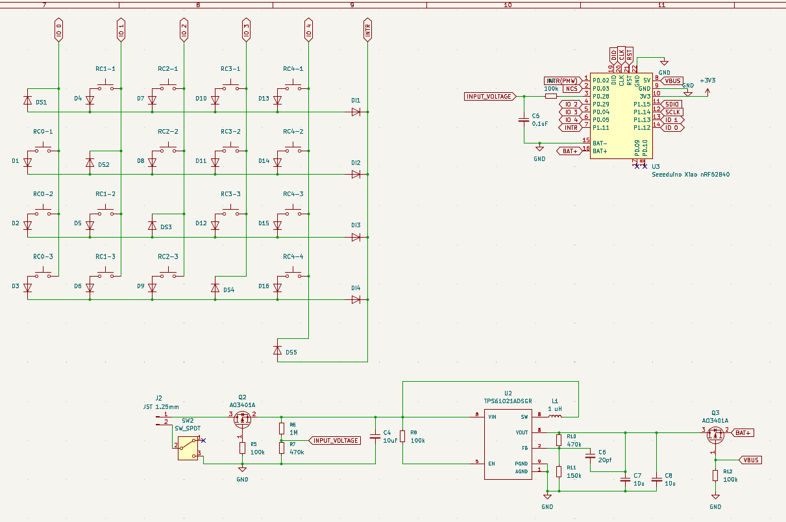
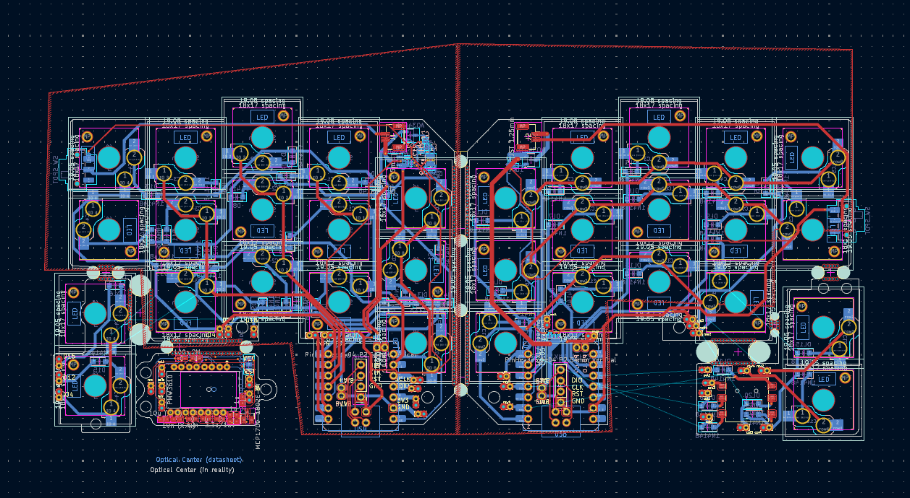
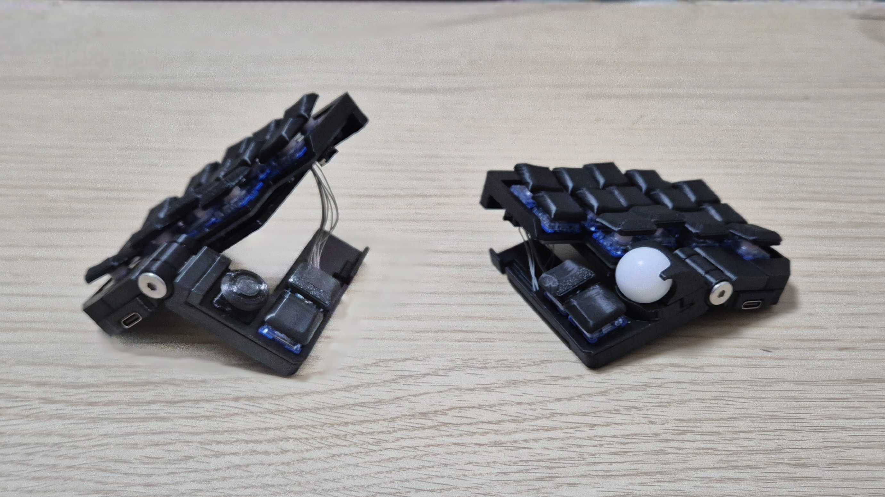

# Kestrel

Kestrel is a wireless Bluetooth split keyboard with a distinctive layout: a 3×5 − 2 main layout on both the left and right halves, each with two vertically arranged thumb keys.

The right half has a 19 mm trackball using the PMW3610 sensor, and the left half mirrors it with a 5-way switch. In total the keyboard has 32 + 5 keys (the 5 being the inputs of the 5-way switch).

It is designed with portability and usability in mind.

> [!WARNING]
> **Right Half Charging Issue**
>
> There are reports that the right half does not charge properly because of the MOSFET placed in its charging circuit for reverse-current blocking.
>
> Removing this MOSFET and shorting its pads is the recommended workaround. Note that this also removes the reverse-current protection.

## Features

- Wireless Bluetooth split keyboard running ZMK
- 3×5 − 2 main layout with two vertical thumb keys per half
- 19 mm trackball (PMW3610) on the right half
- 5-way switch on the left half
- 3D-printed integrated hinge that bends close to 90° and provides built-in tenting
- Charlieplex matrix on the right half, with a dedicated 3V3 DC/DC converter circuit

## Specifications

| Item | Description |
|---|---|
| Form Factor | Split, wireless (Bluetooth) |
| Main Layout | 3×5 − 2, plus 2 vertical thumb keys per half |
| Keys | 32 + 5 (5-way switch) |
| Right Half | 19 mm trackball (PMW3610), charlieplex matrix, 3V3 DC/DC converter, central |
| Left Half | 5-way switch, standard key matrix, peripheral |
| Firmware | ZMK |
| Case | 3D-printed with integrated hinge |

## Hardware

### Hinge

The most distinctive feature of Kestrel is its 3D-printed hinge.

The built-in hinge bends close to 90° and supports tenting on its own. It keeps a suitable amount of torque for use on a keyboard.

### Left Half: 5-Way Switch

The left half uses a regular key matrix so that the 5-way switch can be included.

The 5-way switch supports a center click and pushing in four directions. However, it is prone to accidental inputs and its lifespan is not expected to be long. For this reason it is used for conservative functions such as arrow keys and switching between QWERTY and Colemak layers.

### Right Half: Trackball and Charlieplex Matrix

The right half uses a charlieplex matrix to work around the limited number of pins caused by the trackball. Because the trackball is on the right, the right half acts as the central and the left half as the peripheral.

Unlike col2row (or row2col) matrices, charlieplex pins have no fixed input and output roles, which makes it prone to ghosting. Charlieplex keyboards commonly deal with this by using the voltage drop across different numbers of diodes, so that a ghosted key falls outside the input range of the pin.

For this to work reliably, the supply voltage must stay constant. The right half therefore includes an additional 3V3 DC/DC converter circuit. Without it, ghosting increases sharply as the battery level drops.

> [!NOTE]
> The BOM for this design uses a WSON package for the 3V3 converter. If you do not order a PCBA, you will need to hand-solder the WSON package yourself. Modifying the circuit to use a similar-performance package that is easier to hand-solder is recommended.

### PCB

### Credits

- The charlieplex matrix is based on [Hooky's round-robin schematics](https://github.com/HookyKB/round-robin-schematics).
- The 3V3 circuit is based on [DYA Dash](https://github.com/cormoran/dya-dash-keyboard).
- The PMW3610 breakout board is a modified version of [ufan's pmw3610_breakout](https://github.com/ufan/pmw3610_breakout).

## Firmware

Kestrel runs on [ZMK Firmware](https://zmk.dev/).

The keyboard-specific configuration is maintained in a separate repository:

**[Kestrel ZMK Configuration](https://github.com/HNBN9/zmk-config-kestrel)**

The firmware files show how different matrices are applied to each half in ZMK. The matrix transform is shared between both halves, while the `kscan` configuration is written separately for the left and right halves.

## Gallery

## Known Issues

- The reverse-current blocking MOSFET in the right half's charging circuit has been reported to prevent proper charging. Remove the MOSFET and short its pads as a workaround (this removes the reverse-current protection).

## Repository Status

This repository currently contains the case STEP files and PCB-related files.

## License

This project uses separate licenses for software and non-software materials.

| Material | License |
|---|---|
| Firmware configuration and source code | [MIT License](./LICENSE-MIT) |
| Hardware design files (PCB, case), documentation, photographs, and renders | [CC BY-NC 4.0](./LICENSE-CC-BY-NC) |

Parts derived from other projects (see [Credits](#credits)) remain subject to the terms of their original authors.

ZMK Firmware itself is distributed under its own license; see the [ZMK repository](https://github.com/zmkfirmware/zmk).
